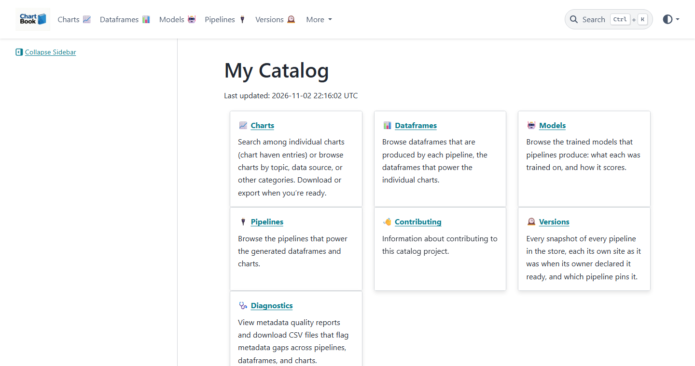
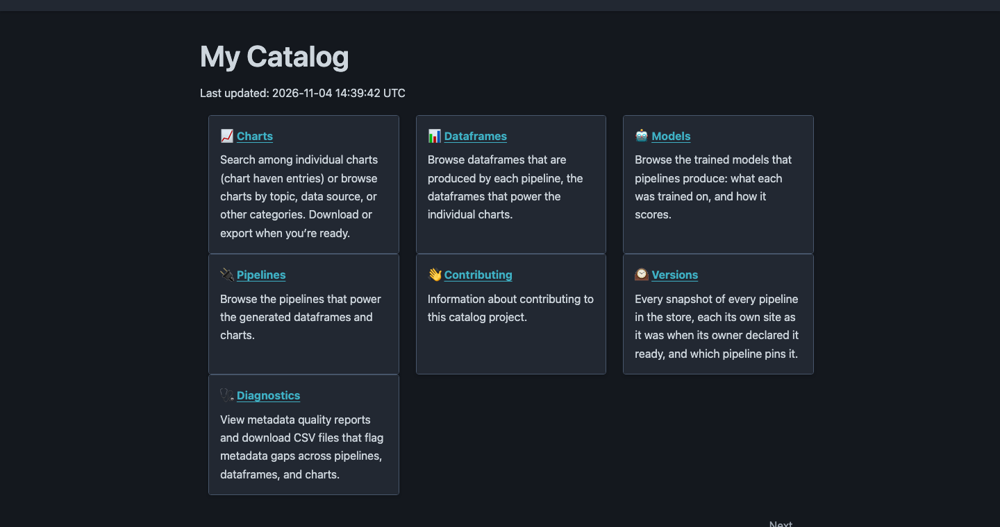
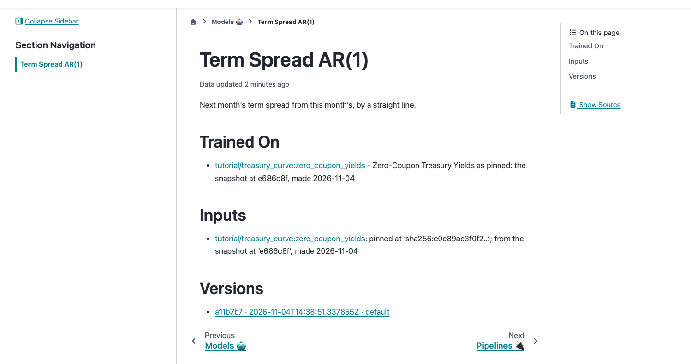
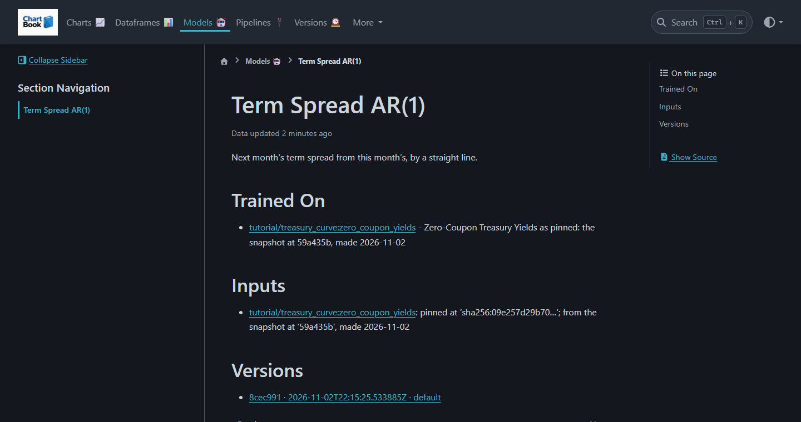

# ChartBook

<div class="cb-hero">
<p class="cb-hero-title">Composable data pipelines for humans and agents.</p>
<p class="cb-hero-sub">Give your coding agents a living catalog of every dataset, chart, and model.
Snapshot pipelines like packages, compose them safely, and verify every number they touch.</p>
</div>

```{code-block} bash
:class: cb-hero-install
pip install chartbook
```

<div class="cb-hero-bar">
<a class="cb-btn-primary" href="getting-started.html">Quickstart: 5 Minutes</a>
<a class="cb-btn-secondary" href="tutorials/explore-a-catalog.html">Explore a Catalog</a>
</div>

```{raw} html
<div class="cb-showcase" id="cb-hero-showcase">
  <div class="cb-showcase-tabs" role="tablist" aria-label="ChartBook demo views">
    <button type="button" class="cb-showcase-tab" role="tab" aria-selected="true" data-slide="0">Agent CLI &amp; Python</button>
    <button type="button" class="cb-showcase-tab" role="tab" aria-selected="false" data-slide="1">Team Catalog Site</button>
    <button type="button" class="cb-showcase-tab" role="tab" aria-selected="false" data-slide="2">Verified Lineage</button>
  </div>

  <div class="cb-showcase-stage">
    <div class="cb-showcase-slide is-active" data-slide="0">
      <video autoplay muted playsinline aria-label="Terminal recording: chartbook ls dataframes, chartbook get-docs, chartbook path, and Python data.load">
        <source src="_static/tapes/catalog.webm" type="video/webm">
        <source src="_static/tapes/catalog.mp4" type="video/mp4">
      </video>
    </div>

    <div class="cb-showcase-slide" data-slide="1">
      
      
    </div>

    <div class="cb-showcase-slide" data-slide="2">
      
      
    </div>
  </div>

  <p class="cb-showcase-caption" id="cb-showcase-caption">
    Your agents query the catalog from the terminal (<code>chartbook ls</code>, <code>get-docs</code>, <code>path</code>) and load pinned data directly in Python with <code>data.load()</code>.
  </p>
</div>

<script>
(function () {
  const root = document.getElementById("cb-hero-showcase");
  if (!root) return;
  const tabs = Array.from(root.querySelectorAll(".cb-showcase-tab"));
  const slides = Array.from(root.querySelectorAll(".cb-showcase-slide"));
  const caption = document.getElementById("cb-showcase-caption");
  const captions = [
    'Your agents query the catalog from the terminal (<code>chartbook ls</code>, <code>get-docs</code>, <code>path</code>) and load pinned data directly in Python with <code>data.load()</code>.',
    'One searchable catalog website over every pipeline, dataset, chart, model, and version in your shared stores—built automatically with <code>chartbook catalog open</code>.',
    'Every downstream chart and model records its exact upstream commit and content hash, so you can verify everything your team and agents build.'
  ];

  let idx = 0;
  let timer = null;
  let paused = false;

  function show(next, userInitiated) {
    idx = (next + slides.length) % slides.length;
    tabs.forEach((t, i) => t.setAttribute("aria-selected", String(i === idx)));
    slides.forEach((s, i) => s.classList.toggle("is-active", i === idx));
    caption.innerHTML = captions[idx];

    const vid = slides[0].querySelector("video");
    if (vid) {
      if (idx === 0) {
        vid.currentTime = 0;
        vid.play().catch(() => {});
      } else {
        vid.pause();
      }
    }

    clearTimeout(timer);
    if (userInitiated) paused = true;
    if (!paused) scheduleNext();
  }

  function scheduleNext() {
    clearTimeout(timer);
    if (idx === 0) {
      const vid = slides[0].querySelector("video");
      if (vid) {
        vid.onended = () => { if (!paused) show(1, false); };
        return;
      }
    }
    timer = setTimeout(() => { if (!paused) show(idx + 1, false); }, 6500);
  }

  tabs.forEach((tab, i) => {
    tab.addEventListener("click", () => show(i, true));
  });

  root.addEventListener("mouseenter", () => { clearTimeout(timer); });
  root.addEventListener("mouseleave", () => { if (!paused && idx !== 0) scheduleNext(); });

  const vid = slides[0].querySelector("video");
  if (vid) {
    vid.onended = () => { if (!paused) show(1, false); };
  }
})();
</script>
```

## Why ChartBook

::::{grid} 1 2 2 2
:gutter: 3

:::{grid-item-card} {octicon}`hubot;1.5em` A skills catalog for your agents
:link: guide/agents
:link-type: doc
Run `chartbook install agents` once so Claude Code, Cursor, and other coding agents can search your catalog, read schemas, load clean data, and audit lineage (`chartbook lineage`) without guessing paths.
:::

:::{grid-item-card} {octicon}`package-dependencies;1.5em` Snapshot pipelines like packages
:link: guide/depending-on-pipelines
:link-type: doc
Split large analyses into modular repos that snap together cleanly. `chartbook snapshot` freezes a committed build by content hash; downstream projects pin it in `chartbook.lock` and update only when you choose.
:::

:::{grid-item-card} {octicon}`sync;1.5em` Share artifacts across machines & teams
:link: guide/catalogs-and-data
:link-type: doc
Point your store at Google Drive, Dropbox, OneDrive, or a shared drive—no server required. Share datasets, trained models, and build artifacts seamlessly across teammates, laptops, and parallel agents.
:::

:::{grid-item-card} {octicon}`book;1.5em` One searchable site with verified lineage
:link: guide/documenting-a-pipeline
:link-type: doc
Describe your dataframes, charts, models, and notebooks in `chartbook.toml`. ChartBook turns them into browsable pages with automatic data glimpses and hash-verified provenance back to every source.
:::

::::

## Four commands cover 95% of your day

<p class="cb-section-lead">You don't need to learn a sprawling framework. Once a pipeline has a small <code>chartbook.toml</code> manifest, four everyday commands handle building, snapshotting, updating dependencies, and browsing your catalog.</p>

<div class="cb-cmd-grid">
  <div class="cb-cmd-card">
    <span class="cb-cmd-step">1. Build</span>
    <code class="cb-cmd-code">chartbook run</code>
    <p class="cb-cmd-desc">Pins any new dependencies, runs your build script, and verifies that every declared output was created.</p>
  </div>
  <div class="cb-cmd-card">
    <span class="cb-cmd-step">2. Snapshot</span>
    <code class="cb-cmd-code">chartbook snapshot</code>
    <p class="cb-cmd-desc">Freezes a committed build into your store by content hash so other pipelines, teammates, and agents can use it.</p>
  </div>
  <div class="cb-cmd-card">
    <span class="cb-cmd-step">3. Update</span>
    <code class="cb-cmd-code">chartbook pin --update</code>
    <p class="cb-cmd-desc">Pulls the newest snapshots from upstream pipelines into <code>chartbook.lock</code> when <em>you</em> are ready.</p>
  </div>
  <div class="cb-cmd-card">
    <span class="cb-cmd-step">4. Browse</span>
    <code class="cb-cmd-code">chartbook catalog open</code>
    <p class="cb-cmd-desc">Builds and opens one searchable website covering every pipeline, dataset, chart, and version in your stores.</p>
  </div>
</div>

Two one-time helpers round it out: `chartbook install agents` teaches your coding agent how to use your catalog, and `chartbook init` scaffolds a batteries-included project if you want a full template.

## One catalog for your team and your agents

<p class="cb-section-lead">Humans browse the catalog website; coding agents query the exact same metadata through a lightweight, token-efficient CLI and <code>llms.txt</code>.</p>

| Question | Your team, in the browser | Your agents, in the terminal |
|---|---|---|
| **What exists?** | Catalog home page & search | `chartbook ls --json` or `llms.txt` |
| **What is this dataset?** | Dataset page, schema & glimpse | `chartbook get-docs yield_curve:repo_public` |
| **How do I use it?** | Copy-paste snippet on the page | `data.load("yield_curve:repo_public")` or `chartbook path` |
| **Can I trust it?** | Provenance table & Versions page | `chartbook lineage --json` & `chartbook.lock` |

## Minimal by design—works with any stack

<p class="cb-section-lead">ChartBook never locks you into a workflow engine. Keep your existing Python scripts, R, Stata, SQL, or Makefiles—just describe what the folder produces in <code>chartbook.toml</code>.</p>

<div class="cb-stack-row">
  <span class="cb-stack-pill">Python</span>
  <span class="cb-stack-pill">Polars &amp; Pandas</span>
  <span class="cb-stack-pill">DuckDB</span>
  <span class="cb-stack-pill">R &amp; Stata</span>
  <span class="cb-stack-pill">SQL &amp; Notebooks</span>
  <span class="cb-stack-pill">Claude Code &amp; Cursor</span>
  <span class="cb-stack-pill">Git</span>
</div>

::::{tab-set}

:::{tab-item} chartbook.toml
```{literalinclude} _examples/quickstart/chartbook.toml
:language: toml
```
:::

:::{tab-item} src/build_chart.py
```{literalinclude} _examples/quickstart/src/build_chart.py
:language: python
```
:::

:::{tab-item} Terminal
```console
$ chartbook run                              # runs build script & checks outputs
$ git add -A && git commit -m "First build"
$ chartbook snapshot                         # saves verified snapshot to your store
$ chartbook catalog open                     # opens the catalog in your browser
```
:::

::::

Once snapshotted, any other pipeline—or any coding agent—can load that dataset by name, pinned to those exact bytes:

```python
from chartbook import data

walks = data.load("my_pipeline:walks")
```

```{image} _static/diagrams/ecosystem-light.svg
:alt: Pipelines in Python, R and Stata each publish snapshots to one store; the catalog site, your agents and downstream pipelines read from it
:class: only-light
:align: center
```

```{image} _static/diagrams/ecosystem-dark.svg
:alt: Pipelines in Python, R and Stata each publish snapshots to one store; the catalog site, your agents and downstream pipelines read from it
:class: only-dark
:align: center
```

## Where to go next

::::{grid} 1 2 2 2
:gutter: 3

:::{grid-item-card} {octicon}`rocket;1.4em` Quickstart (5 min)
:link: getting-started
:link-type: doc
Build your first minimal pipeline, take a snapshot, and open your catalog.
:::

:::{grid-item-card} {octicon}`hubot;1.4em` Working with AI Agents
:link: guide/agents
:link-type: doc
Turn your catalog into a skills layer for Claude Code, Cursor, and other agents.
:::

:::{grid-item-card} {octicon}`repo-forked;1.4em` Linking Pipelines Together
:link: guide/depending-on-pipelines
:link-type: doc
Depend on upstream snapshots, lock exact versions, and update safely with `pin --update`.
:::

:::{grid-item-card} {octicon}`book;1.4em` Explore a Real Catalog
:link: tutorials/explore-a-catalog
:link-type: doc
Hands-on tutorial: connect three public-data pipelines and audit a model back to its source.
:::

::::

```{toctree}
:hidden:
:caption: Get Started

getting-started
tutorials/explore-a-catalog
```

```{toctree}
:hidden:
:caption: Core Use Cases

guide/agents
guide/depending-on-pipelines
guide/catalogs-and-data
guide/documenting-a-pipeline
```

```{toctree}
:hidden:
:caption: Guides

guide/starting-a-project
guide/reading-and-writing-data
guide/keeping-costly-outputs
guide/plotting
guide/reading-a-warehouse
guide/plotting-backends
guide/gallery
```

```{toctree}
:hidden:
:caption: Reference

reference/cli
reference/configuration
reference/api
guide/vocabulary
guide/how-the-build-works
reference/stability
```

```{toctree}
:hidden:
:caption: Project

examples
changelog
roadmap
contributing
```
